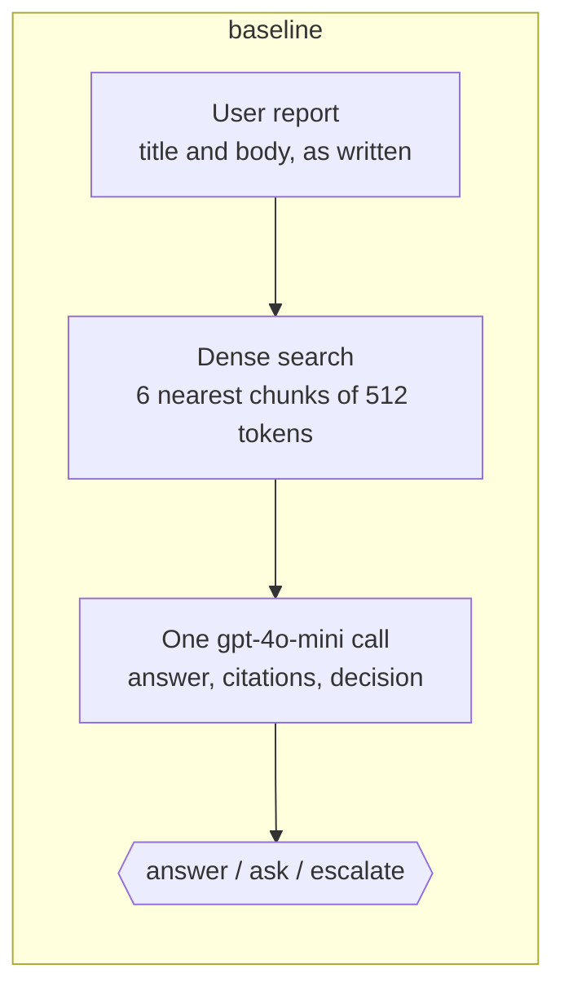
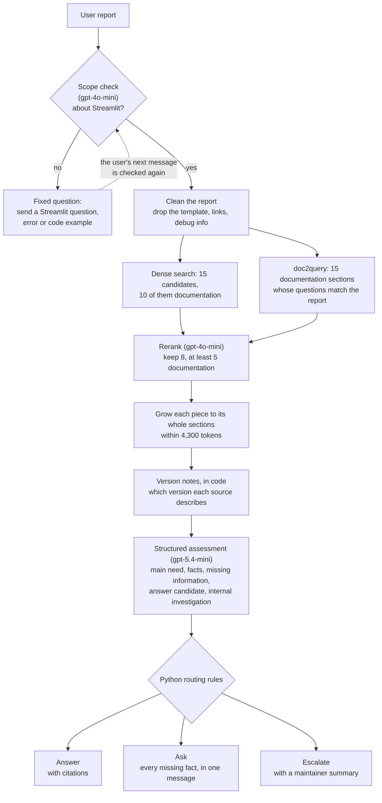

# streamlit supportdesk

A technical-support assistant for [Streamlit](https://streamlit.io), focused on Session State and its
interaction with widgets, callbacks, forms and multipage apps. Given a user's problem report, it searches
the Streamlit documentation, earlier GitHub issues and comments, and release notes, then does one of
three things:

- **answers**, citing the evidence it used;
- **asks** for the facts that would decide the case (the version, a minimal reproduction, ...);
- **escalates** to a maintainer, with a technical summary.

Everything runs locally: a fixed corpus, a local vector store, and a local tracker for case follow-up.
All tests and the demo run offline, for free, with fake models.

## Results

Fifteen development cases and fifteen held-out test cases, each labelled with the decision it calls for.
The design was chosen on the development cases; the test split was run once, at the end.

| | `baseline` | `advanced` | `advanced-gpt5mini` |
|---|---:|---:|---:|
| Gold evidence passages in the prompt, dev / test | 5.7% / 0% | 73.2% / 45.0% | as `advanced` |
| Correct decisions of 15, dev / test | 5 / 6 | 12 / 6 | 11 / 8 |
| Answers citing gold evidence, test | 0% | 100% | 87.5% |
| Independent LLM judge, test: pass / partial / fail | 1 / 2 / 12 | 5 / 2 / 8 | 6 / 3 / 6 |
| Cost per case | ~$0.0008 | ~$0.024 | ~$0.009 |

The final design reliably brings the right evidence and grounds its answers; its decision gain on the
development cases did not carry over to the test cases, where telling a question from an escalation
remained the main weakness. All results, with confusion matrices, retrieval funnels, the judge's
verdicts, cost and time, and how to reproduce them, are in `docs/results/README.md`; everything that was
tried is in `docs/pipelines.md`.

The judge is an LLM from a different model family than the answer model (Claude Opus 5.5). It reads one
case at a time: the report, the decision, the exact evidence the model saw, and the case's rubric, and
returns a pass, partial or fail verdict with scores and a failure analysis. Its prompt is
`configs/prompts/judge_case_system.txt`; the criteria are explained in `docs/evaluation/judge_prompt.md`.

## How it works

Two LangGraph graphs. Indexing runs once:

```
load -> screen (personal data, secrets) -> chunk (evaluation cases left out) -> audit leakage -> embed -> store (Qdrant)
```

Every report then runs through the support graph. The two main designs:





The model in `advanced` never picks the action itself: it fills a structured assessment, and fixed
rules in Python choose (`docs/generation/README.md`). `advanced-gpt5mini` is the same design with the
cheaper `gpt-5-mini` answer model.

**Case follow-up.** `supportdesk case` wraps the support graph in a third graph with a local tracker
(SQLite). An escalation is recorded as a proposal and the graph pauses (LangGraph `interrupt`) until a
maintainer approves, edits or rejects it with `supportdesk review`; with `--set case.review=all`, every
reply waits for approval. State is checkpointed, so a pause survives a restart.

## Quick start (offline, free, no key)

Python 3.10 or newer.

```bash
python -m pip install -e ".[dev,live]"
make test                                       # all tests, offline

export SUPPORTDESK_CONFIG=configs/sample.toml   # a small synthetic corpus
supportdesk index
supportdesk ask --title "st.session_state lost after refresh" --body "Values reset on F5"
supportdesk web                                 # the web page, at http://127.0.0.1:8765
```

`make demo` runs everything on the sample at once: it indexes, evaluates both main pipelines, and writes
a comparison report (`artifacts_sample/reports/report.html`) and a snapshot of each pipeline. Offline
mode uses fake models, so everything runs but the answer text comes from a template.

## Going live

Leave the sample first: `unset SUPPORTDESK_CONFIG`.

1. **Key:** `cp .env.example .env` and set `OPENAI_API_KEY`. `OPENAI_BASE_URL` is optional: set it to use
   any OpenAI-compatible endpoint instead of api.openai.com.
2. **Prices:** put your provider's prices in `configs/pricing.json` and set `"verified": true`. Live
   mode refuses to start until then, because the budget guard relies on them.
3. **Budget:** spending is tracked on this machine and stops at `budget.ceiling_usd`; set your own limit
   in `.env`, for example `SUPPORTDESK__BUDGET__CEILING_USD=1`.
4. **Index once:** `supportdesk index --mode live` embeds the corpus (under one cent).
5. **doc2query questions (for `advanced`):** `python scripts/build_section_questions.py --mode live`
   writes them into `data/questions` (about $0.02). The repository already includes a built set;
   rebuild it only if the documentation in the corpus changes.
6. **Ask:** `supportdesk ask --mode live --pipeline advanced --title "..." --body "..."`, or
   `supportdesk web --mode live --pipeline advanced`.

To stay live without typing `--mode live`, add `SUPPORTDESK__RUN__MODE=live` to `.env`; every command
then spends money until you remove it. Repeated requests are served from a local cache for free.

## Configuration

Settings live in `configs/default.toml`; each pipeline overrides some in its profile. Any setting can
also be set, from lowest to highest priority, in a file named by `SUPPORTDESK_CONFIG` or `--config FILE`,
in `.env` or the environment as `SUPPORTDESK__SECTION__KEY=value`, or on the command line as
`--set section.key=value`. `supportdesk config` shows each value and where it came from; every setting is
listed in `docs/configuration.md`.

The mode is the setting `run.mode`: `offline` (fake models, the default), `replay` (recorded responses
only, never a cost) or `live` (real calls).

## Pipelines

| Pipeline | Profile | What it is |
|---|---|---|
| `baseline` | `configs/pipelines/baseline.toml` | The reference: dense search, 6 chunks, one `gpt-4o-mini` call. Pinned by tests. |
| `advanced` | `configs/pipelines/advanced.toml` | The final design, as in the diagram. |
| `advanced-gpt5mini` | `configs/pipelines/advanced-gpt5mini.toml` | The final design with `gpt-5-mini`: about a third of the cost; never escalated. |

Around a hundred experiments are kept, each changing one thing, with their profiles grouped by what they
test in `configs/pipelines/experiments/` (`search`, `query`, `chunking`, `loop`, `candidates`, `answer`,
`scope`, `hier_class`). Select any of them by name with `--pipeline NAME`; `supportdesk pipelines` lists
them all, and `docs/pipelines.md` describes them with their results.

## Commands

| Command | What it does |
|---|---|
| `supportdesk ask --title "..." --body "..."` | Answer one report; nothing is posted |
| `supportdesk web` | Local web page for the main pipelines: saved multi-turn conversations, the evidence the model saw, evaluation runs, downloads |
| `supportdesk case CASE-1 --title "..." --body "..."` | Open a case (a follow-up is `--body` only) and act on the answer |
| `supportdesk review CASE-1` | Show what is waiting; decide with `--approve`, `--edit "TEXT"` or `--reject` |
| `supportdesk tracker CASE-1` | The case's messages, notes and events (`--reset` clears the tracker) |
| `supportdesk eval-retrieval --pipeline advanced --split dev` | Retrieval quality only: gold passages in the prompt, Recall@k, MRR |
| `supportdesk eval --pipeline advanced --split dev` | Full evaluation: decisions, citations, cost and time per case |
| `supportdesk report RUN_ID RUN_ID` | Compare runs side by side (HTML) |
| `supportdesk snapshot --pipeline advanced` | A pipeline's stages, settings and one traced run (`--all`: the three main pipelines) |
| `supportdesk pipelines` | Every registered pipeline |
| `supportdesk check-cases` | Check the evaluation files against the corpus and index |
| `supportdesk config` | Every setting and where its value comes from |
| `python scripts/confusion_matrix.py RUN_ID ...` | Decision confusion matrices, as Markdown |
| `python scripts/export_cases.py RUN_ID` | One JSON file per case, for review or an LLM judge |
| `make test` / `make lint` / `make demo` | All tests / lint / the full offline demo on the sample |

## Data

- `data/processed/corpus.jsonl`: the fixed corpus of 540 records: 126 GitHub issues and 214 comments from
  the Streamlit repository, 54 documentation pages and 35 linked references, and 111 release-note sections.
  Each record keeps its source URL, version or date, evidence role and a checksum; the text is never
  modified, because evidence spans point into it by character offset.
- `data/eval/`: the 15 development and 15 test cases (`development_inputs.jsonl`, `test_inputs.jsonl`) and
  their evaluator-only rubrics (`development_rubrics.jsonl`, `test_rubrics.jsonl`), with 81 and 65 gold
  evidence passages; a synthetic sample; and the scope-check benchmark. Building the index leaves every
  one of these cases' issues out, so neither split can find its own answer.
- `data/questions/`: the doc2query bank: 730 questions for 146 documentation sections, with their embeddings.
- `data/sample/`: a small synthetic corpus for offline runs.
- `data_gathering/`: how the corpus was collected and prepared: the download code for issues, comments,
  documentation and release notes, the frozen v06 dataset with its cleaning and review code, and offline
  validation (`data_gathering/README.md`). Nothing in the system reads from it; exporting its retrieval
  corpus reproduces `data/processed/corpus.jsonl` byte for byte.

The corpus quotes public GitHub issues and comments verbatim, including their code and tracebacks, and
the Streamlit documentation; their original authors and licences apply to that text.

## Repository layout

```
src/supportdesk/          the package: indexing, pipelines and stages, retrieval, answer packages,
                          evaluation, case workflow, web page, model gateway (cache, budget, ledger)
configs/                  default settings, pipeline profiles (main ones on top, experiments/ below),
                          prompts, prices, the sample configuration, and overlays/: small example
                          files applied on top of any pipeline with --config
data/                     corpus, evaluation files, doc2query bank, sample, experiment inputs
data_gathering/           how the corpus was collected and prepared (separate; its own README)
docs/                     results, configuration, evaluation, pipelines, schemas, the answer step,
                          snapshots, and write-ups of the experiments (docs/experiments/)
scripts/                  one-off tools: question bank, diagnostics, case export, judge agreement
tests/                    offline tests with fake models; golden tests pin the baseline
```

## Further reading

| File | For |
|---|---|
| `docs/results/README.md` | All results of the main pipelines, on both splits, and how to reproduce them |
| `docs/pipelines.md` | Stages and the options for each, the main and experimental pipelines, their results |
| `docs/evaluation.md` | Evaluation files, metrics, the LLM judge, the test split |
| `docs/evaluation/judge_prompt.md` | The LLM judge's criteria; its exact prompt is `configs/prompts/judge_case_system.txt` |
| `docs/generation/README.md` | The answer step: structured assessment, routing, version notes, complete questions |
| `docs/scope_classifier.md` | The scope check and its benchmark |
| `docs/configuration.md` | Every setting, and how layers override each other |
| `docs/schemas.md` | The output of every step, field by field |
| `docs/snapshots/` | Each main pipeline's stages, settings and one traced case |
| `docs/experiments/README.md` | How to try an option, measure it and compare it; write-ups of earlier experiments |
| `CLAUDE.md` | For contributors: where code lives, adding a stage or pipeline, the rules every change follows |
